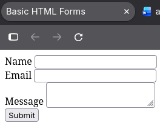
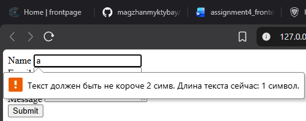
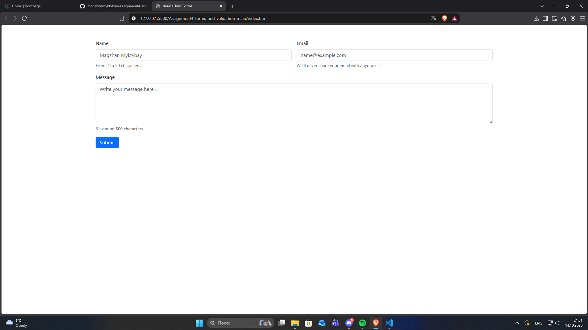
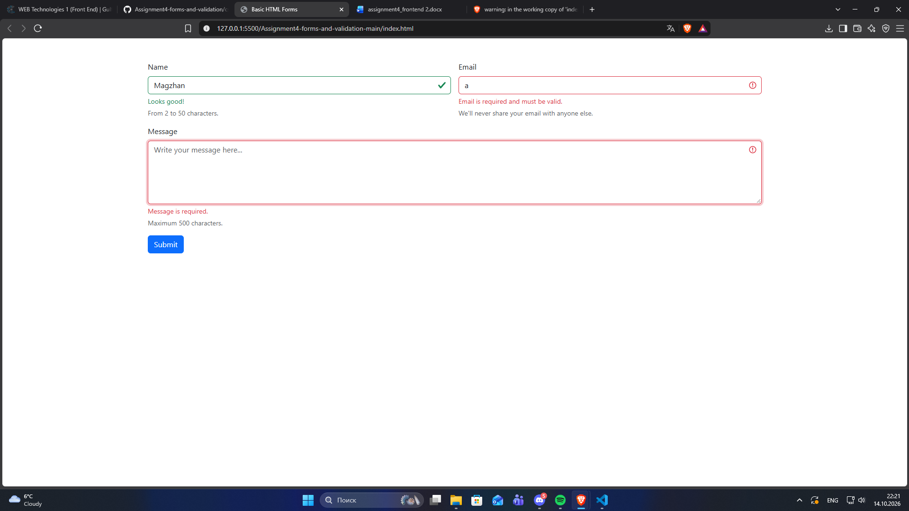
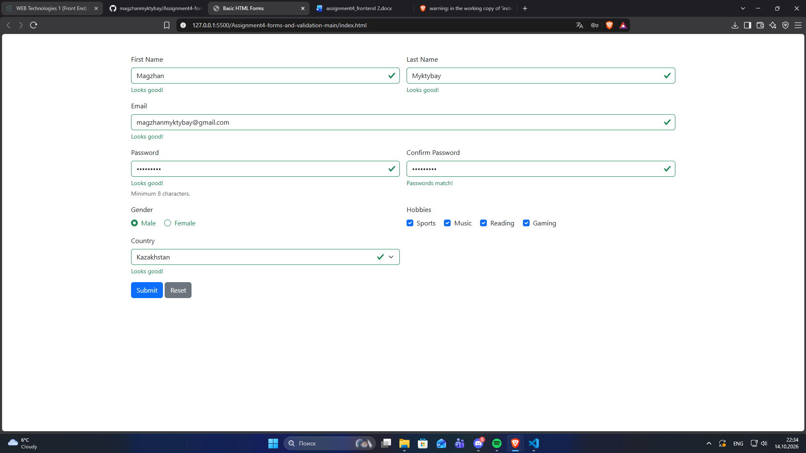

# Assigment 4. Forms and Validation
## Magzhan Myktybay SE-2540
## Part 1
### Task 0
\
Simple HTML form where each field has label except submit button.
### Task 1
\
Added validation attributes (required, minlength, maxlength, type) and tested them.
## Part 2
### Task 2
\
Reacreated the contact form by Bootstraps form classes, grid system, placeholder and helper text.
### Task 3
\
Applied Bootstraps validation feedback classes and showed feedback messages.
## Part 3
### Task 4
\
Created registration form, used Bootstrap Grid and HTML5 validation.
## Conclusion
In this assignment I learnd how to create relative forms with validation by using HTML, Bootstrap, Script. It was interesting and I could use information from lectures in practice. I like that I did in this Assigment.